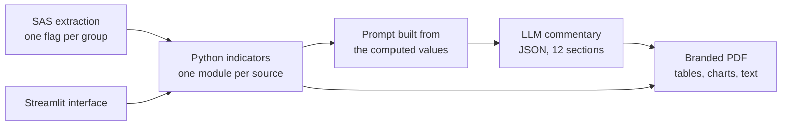

# Automated labour market reports with an LLM

Case study of a pipeline I built for a regional directorate of France Travail, the French public employment service. It produces the labour market notes for each priority group and territory: every figure comes from code (SAS extraction and Python), an LLM writes the commentary, and each note comes out as a branded PDF. The data, the reports and the source code are confidential and are not published here.

    

## Summary

| | |
|---|---|
| Output | one note per priority group and territory, dozens in a single run |
| Sources | six statistical sources: registered jobseekers, access to employment, long-term unemployment, employment after training, hiring declarations and INSEE context data |
| Commentary | written by an LLM as JSON with 12 fixed sections, instructed to use only the figures it is given |
| Users | analysts generate the notes from a small web interface, without code |

## The problem

At each update, the same note is needed for every priority group (seniors, under-26s, welfare recipients, disabled jobseekers, priority urban areas) and every territory (the region and its départements). All the notes share one structure. The goal was to produce them straight from the data, with tables and commentary of consistent quality.

## Approach

Territories, groups, periods and paths are declared in one configuration file. Adding a territory needs no new code; adding a group takes a small commentary module and its text boxes. One shared commentary engine serves four of the five groups. The seniors note, which I built first, keeps its own module with the same structure.

## How the LLM is constrained

The model writes the text around numbers that the code has already prepared. The prompt gives it the values section by section and tells it never to state a figure it was not given. It has to answer with a JSON object of 12 keys, one per section of the note. Each answer is read key by key, so a missing section stays empty instead of breaking the layout.

Every request also carries editorial rules: ignore differences below half a point, speak of stability for small gaps, keep separate comments for related indicators, and use French number formatting. Temperature is set to 0 for near-deterministic output, and a tolerant parser accepts raw JSON, a fenced block or the first object found, so a formatting slip does not stop a run. Decimal points in percentages are converted to French commas afterwards.

In most tables, changes for age bands based on fewer than 30 people are replaced by an asterisk rather than computed on too few people.

## Results

- Every group and territory note produced in one command.
- The same structure and editorial rules across all notes.
- A web interface that lets analysts generate notes without code.

## Stack

Python, pandas, the Anthropic Claude API, fpdf2, matplotlib, Streamlit, openpyxl, with SAS for extraction.

## Code

The code belongs to my employer and is not public. I am happy to walk through the architecture and the prompt design in an interview.
